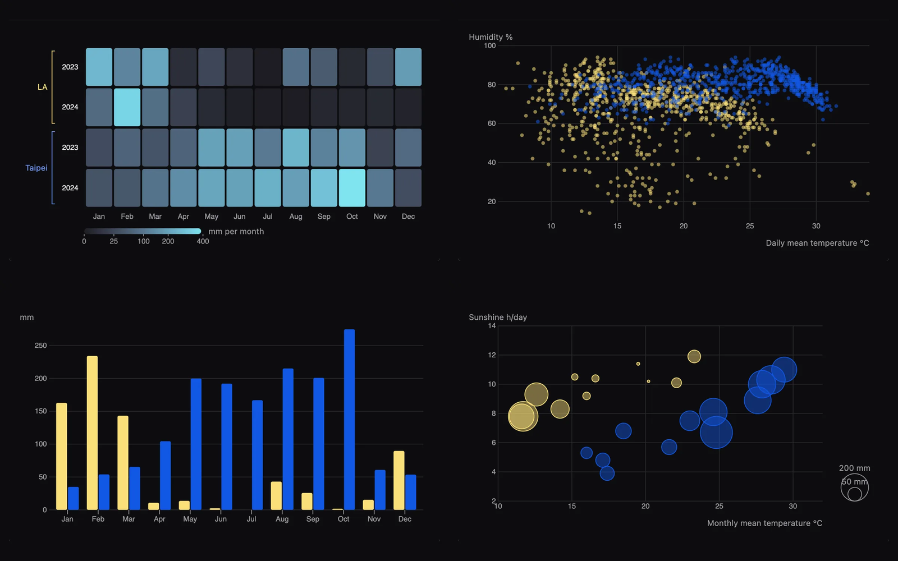

# Rain Check: Los Angeles vs Taipei

Taipei is known for its rain, Los Angeles for its sunshine. Do the numbers agree?

Two years of daily weather in four linked charts. Switch between cities, overlay them, or flip between °C and °F.

**[Live demo](https://lemynsu.github.io/rain-check/)**



## The charts

- **Heatmap**: which months are wet in each city?
- **Scatterplot**: are warmer days more humid?
- **Bar chart**: how much rain falls in a typical month?
- **Bubble chart**: are the sunny months the dry ones?

## Run it

No build step. Serve the folder and open it:

```bash
python3 -m http.server 2000
```

Then visit http://localhost:2000. D3 and Bootstrap are included in `vendor/`.

## Data

Daily weather for 2023 to 2024 from the [Open-Meteo Historical Weather API](https://open-meteo.com/en/docs/historical-weather-api), reduced to small CSVs in `data/`. To refetch:

```bash
npm install
npm run data
```

Built with D3 and Bootstrap by [Evelyn Su](https://evlynsu.com).
